# INFINITY 360

> Nova identidade do projeto anteriormente chamado AuroraX. A estrutura de arquivos e as chaves de configuração legadas são preservadas para compatibilidade; Cloud360 IPTV mantém sua marca.


Protótipo open-source de uma dashboard para Xbox 360 com interface portátil para desenvolvimento no PC. O núcleo já oferece navegação por controle, biblioteca com varredura recursiva de `default.xex`, favoritos, atualização, detalhes, configurações, sistema e gerenciador de arquivos.

> O projeto não inclui exploits, chaves, conteúdo protegido ou meios de contornar segurança. A apresentação Direct3D e o lançamento de títulos usam o projeto XDK. A validação em console e a leitura de temperaturas continuam pendentes.


## Galeria da interface nativa

Capturas 1280 × 720 do renderizador C++ real, com dados de teste locais. Não são fotografias do console. A versão das imagens pode ser anterior à main; confira o [commit de origem](docs/screenshots/source.txt). O [workflow da galeria](https://github.com/MichaelPriest/Infinity360/actions/workflows/dashboard-screenshots.yml) é manual ou disparado por solicitação explícita em `docs/screenshots/request.txt`; não gera XEX nem Release.

<!-- NATIVE-GALLERY-BEGIN -->

**28 capturas publicadas** — fonte [d4594e7](https://github.com/MichaelPriest/Infinity360/commit/d4594e71255b66b87753cff67445c49a7f9d39f3). A atualização V0.2.16 falhou antes da atribuição de runner (run 45705203325); 45 capturas estão preparadas para a próxima solicitação.

| Início | Biblioteca |
| --- | --- |
| 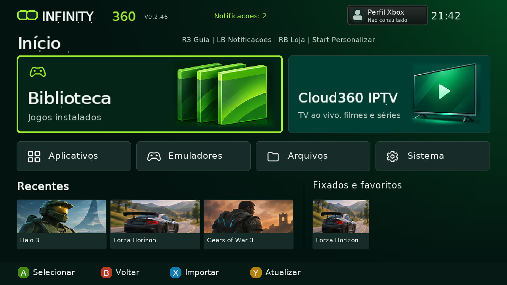 |  |
| Detalhes do título | Loja |
| 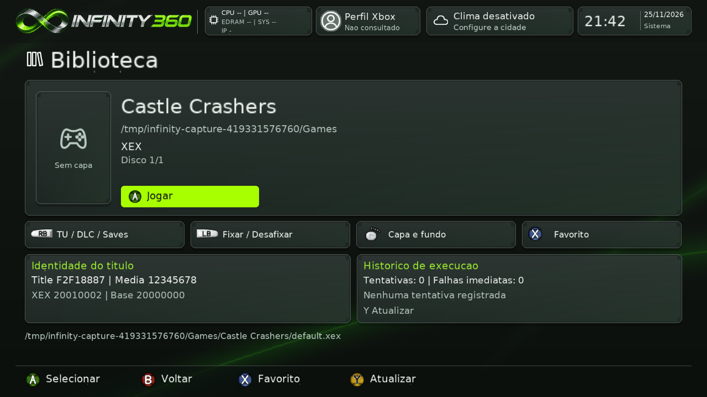 |  |
| Produto | Cloud360 IPTV |
|  |  |
| Sistema | Rede e FTP |
|  | 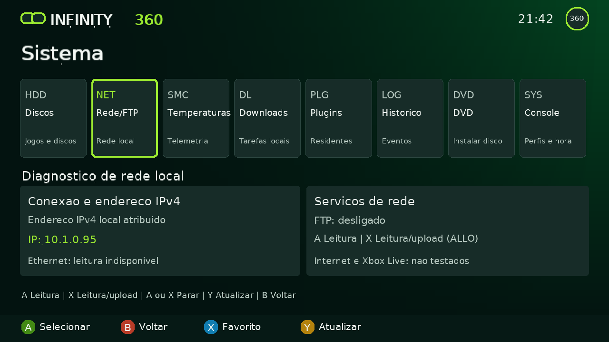 |
| Plugins | Title Updates |
|  |  |
| DLC | Saves |
|  | 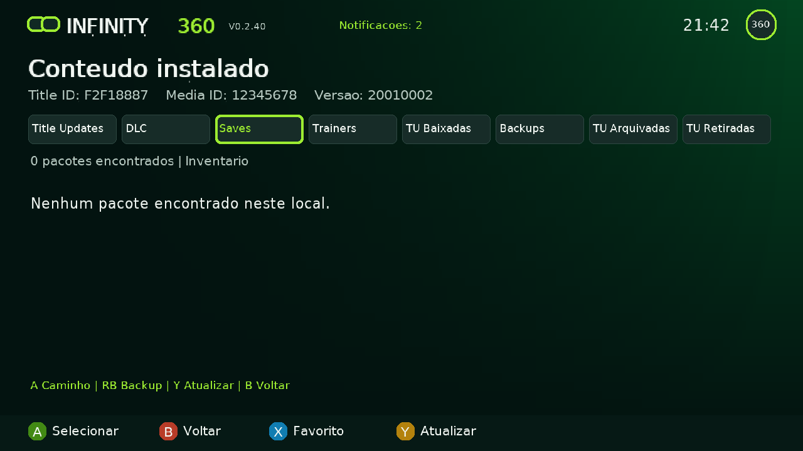 |
| Trainers | TU baixadas |
| 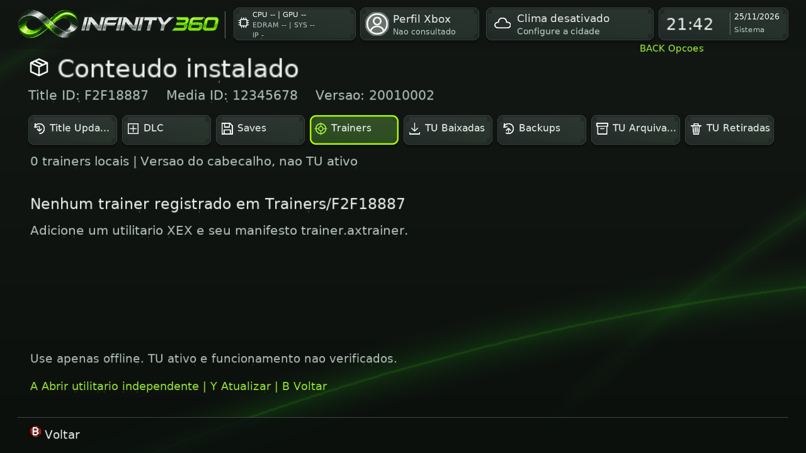 |  |
| Backups | TU arquivadas |
|  | 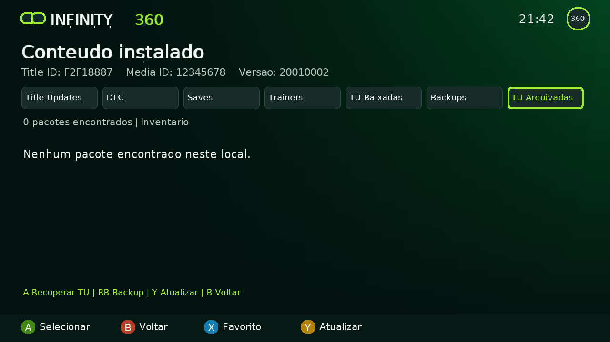 |
| Aplicativos | Emuladores |
| 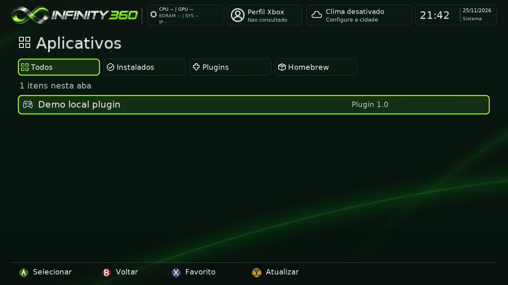 | 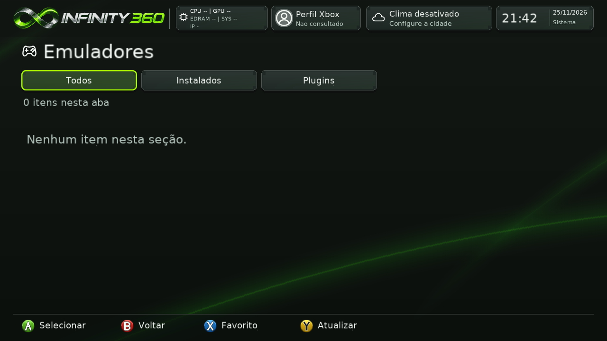 |
| Arquivos | Armazenamento |
| 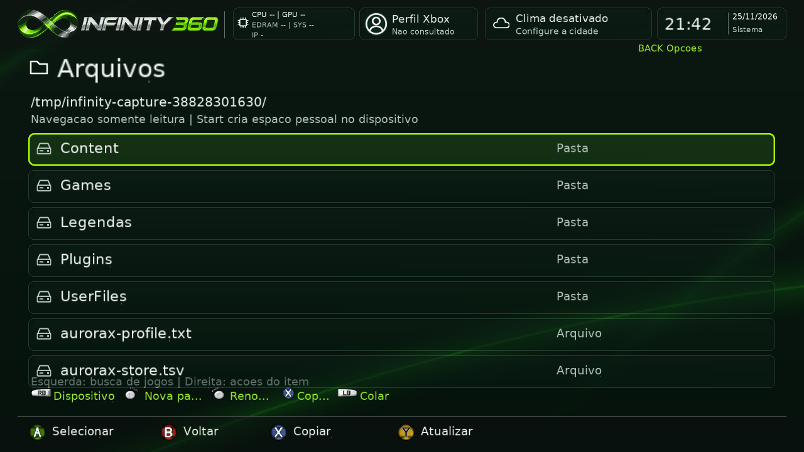 | 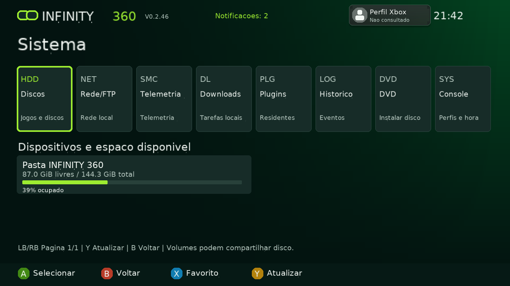 |
| Sensores | Downloads |
| 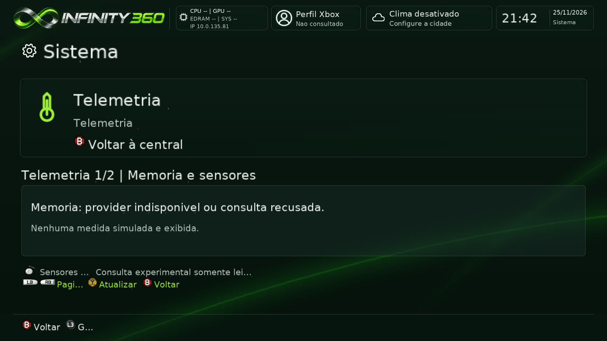 |  |
| Eventos | DVD |
| 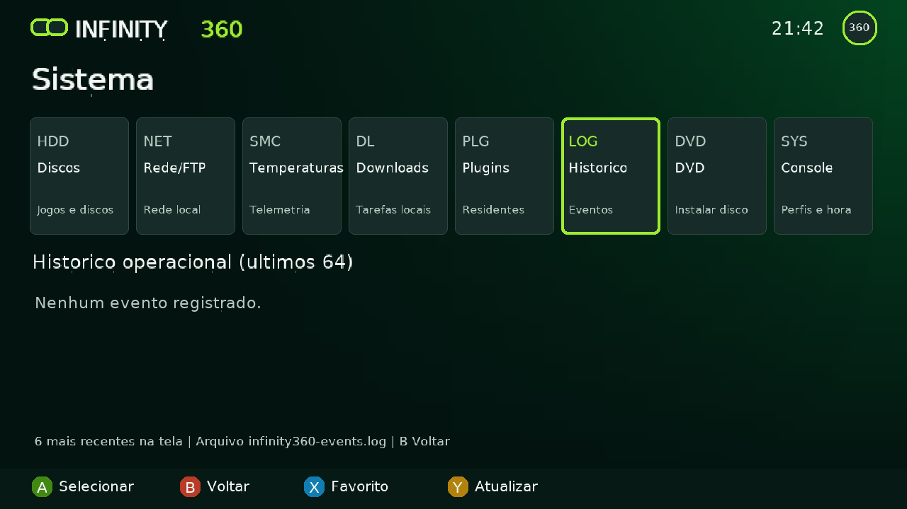 | 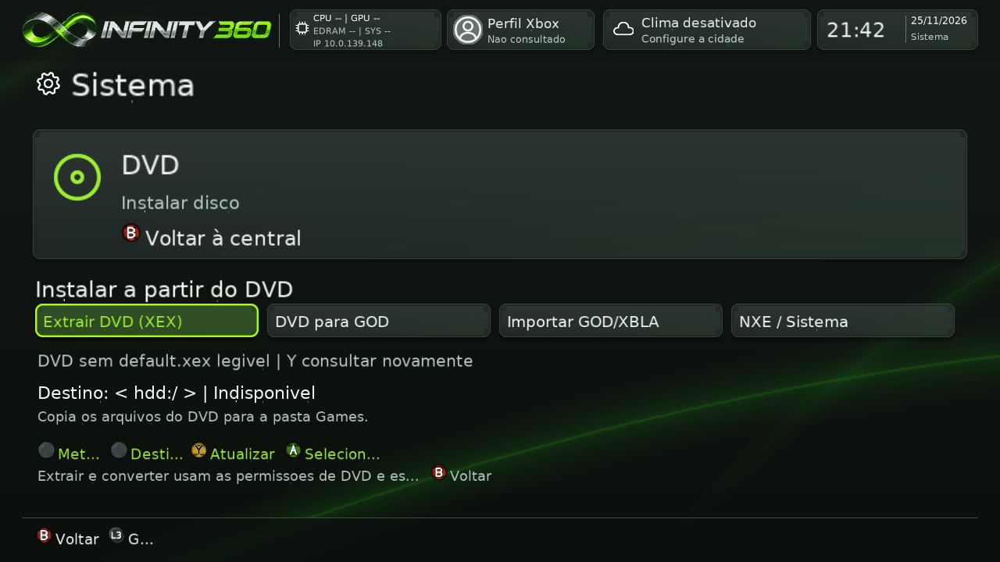 |
| Configurações | TU retiradas |
| 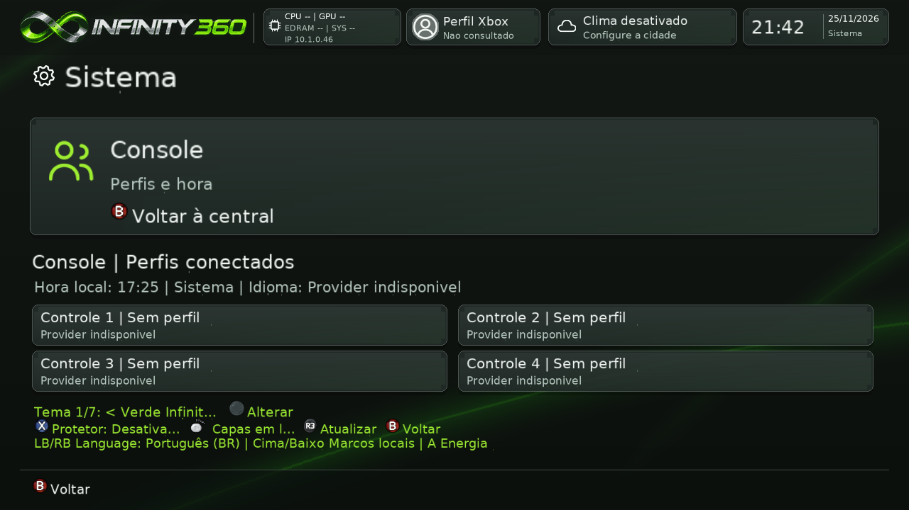 |  |
| Fila da Store | Vídeo e kernel |
| 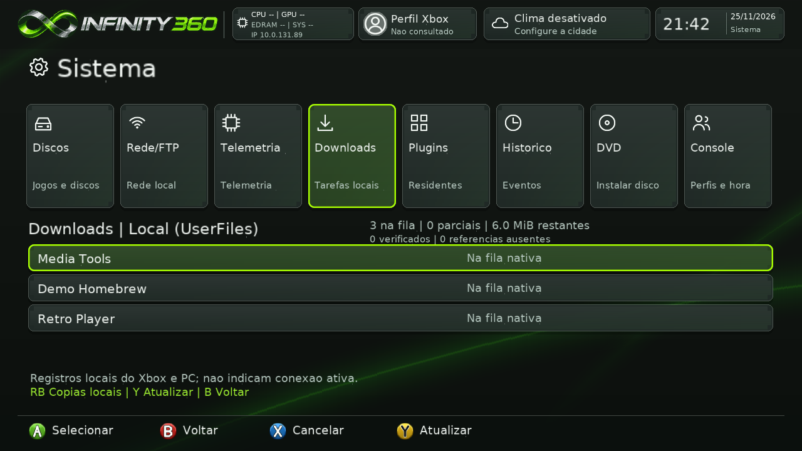 | 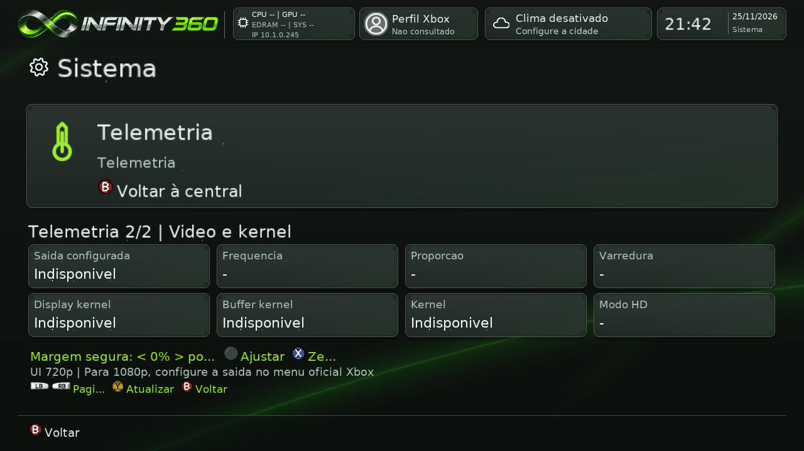 |

<!-- NATIVE-GALLERY-END -->

### Estado atual — código-fonte V0.2.23 (Alpha)

- P0: indexação XEX/GOD/XBLA, importação de pacotes, DVD para XEX/GOD e multidisco no código; lançamento e montagem no console em homologação.
- P1: inventário TU/DLC/saves, staging XboxUnity, instalação local verificada, diagnóstico de Base Version, backups, recuperação de TUs arquivadas e reinstalação de backups TU/DLC elegíveis. Inventário de TUs no Cache legado e ordenação por versão implementados; instalação verificada de TUs legadas no Cache implementada; retirada e recolocação reversíveis de TUs do HDD implementadas; ativação efetiva ainda pendente. Capas e fundos pessoais podem ser arquivados/restaurados no editor de arte. Store com fila persistente, retomada de parciais, priorização, velocidade observada, ETA estimado e seleção de destino HDD/USB com filas independentes; homologação HTTPS e Cloud360 IPTV experimentais. Player MPEG-PS XSDK com correção de aspecto, mute e pausa de arquivo local; HLS/MP4 via conversor. Demux e decodificação H.264/AAC em MP4/MPEG-TS adicionados ao diagnóstico FFmpeg local, com ponte RGB24/PCM, agendamento por PTS, decoder incremental local e fila audiovisual com liberação de quadros consumidos em alvo XSDK separado, com entrada MPEG-TS não-seekable e transporte HTTPS opcional experimental e HLS VOD e live TS sem criptografia com seleção inicial de variante, atualização de janela, controle de sequência e compensação experimental de bloqueios de leitura com read-ahead adaptativo, sem integração ao player principal. CI PowerPC separado tenta compilar FFmpeg 7.1.3 e verificar os XEX experimentais; bibliotecas PowerPC e dois XEX2 experimentais compilados e verificados no CI 45687637748; relink dos dois probes aprovado; nome do ZIP corrigido. Variante experimental da dashboard integra FFmpeg diretamente aos itens MP4/TS/M3U8, com MPEG-PS preservado na Alpha padrão; cross-build da variante aprovado no CI 45691019530; homologação física pendente. Player FFmpeg compartilhado inclui pausa local, mute, volume, painel de controles e navegação MP4 por quadro-chave com tempo/duração. HLS filtra variantes incompatíveis declaradas, aceita limite configurável e tenta alternativas antes da reprodução. Resultados e logs ficam em Actions.
- P2/P3: sensores SMC experimentais com mínimos/máximos, diagnóstico de refrigeração e avisos manuais; energia experimental opt-in, diagnóstico LAN, personalização e indicadores locais parciais. Controle real de ventoinha, System Link efetivo, SMB e conquistas oficiais permanecem pendentes.
- P4 — Modern UI: redesign aprovado em 25/11/2026, inspirado nos conceitos visuais de referência (sidebar, verde-limão/ciano e painéis escuros). Planejado após concluir as funcionalidades P0–P3, sem substituir as telas atuais nesta etapa. [Direção visual e critérios de aceite](Platform/Xbox360/docs/MODERN-UI.md).
- [Roadmap detalhado](Platform/Xbox360/docs/ROADMAP-PRIORITIES.md) · [Releases](https://github.com/MichaelPriest/Infinity360/releases) · [Builds](https://github.com/MichaelPriest/Infinity360/actions)

## Instalar um DVD no Xbox 360

Na Alpha XSDK 0.2.10, abra **Sistema → DVD → DVD para GOD**, selecione o HDD ou USB e confirme com **A** duas vezes. A dashboard lê os arquivos da unidade óptica, gera um pacote SVOD e verifica os fragmentos antes de incluir o jogo na biblioteca do dispositivo. A extração para pasta XEX, a importação de pacotes existentes e a instalação pelo sistema continuam disponíveis nesse menu.

O teste automatizado recupera os arquivos de um pacote gerado e compara o conteúdo com o DVD de teste. A leitura óptica e a aceitação do pacote pelo XAM ainda precisam de confirmação em um Xbox 360. [Versões para download](https://github.com/MichaelPriest/Infinity360/releases) · [Configuração do Xbox 360](IPTV/Cloud360/native/AURORAX-ALPHA-XSDK.md#0210--dvd-para-god)

## Compilar e executar

```sh
cmake -S . -B build
cmake --build build
./build/aurorax
```

Crie jogos de teste como `Games/Nome do jogo/default.xex`. Comandos: `left`, `right`, `up`, `down`, `a`, `b`, `x`, `y` e `back` (ou `q`).

## Interface gráfica

Na raiz do repositório, execute `python -m http.server 8080` e abra `http://localhost:8080/Web/`. No Linux, use `python3` se necessário. O bloco **Cloud360 IPTV** abre o player existente no navegador. O link **← INFINITY 360** retorna com o foco no mesmo bloco.

A tela inicial reúne Biblioteca, IPTV, quatro atalhos e as fileiras Recentes e Favoritos. O direcional ou as setas movem o foco, A ou Enter seleciona e B ou Esc volta. Os jogos da prévia são demonstrativos. Abrir um deles pelo botão Jogar atualiza o histórico deste navegador. Na versão de console, as fileiras usam os jogos encontrados nos dispositivos.

A demonstração inclui tela inicial, biblioteca pesquisável, filtros reais (todos, favoritos, recentes e instalados), ordenação, favoritos persistentes, detalhes, tamanhos, aplicativos, emuladores, arquivos, sistema, menu Guide, status de downloads/FTP e preferências persistentes de tema, perfil, som e movimento. Use `G` ou o botão Guide para abrir o Guide, `B`/`Esc` para voltar, `X` para favoritar o item focado e `Y` para atualizar.

As categorias Xbox 360, Arcade, Kinect, Homebrew e Aplicativos possuem filtros e exemplos próprios. A Loja INFINITY 360 resgata a ideia de catálogo comunitário presente em dashboards clássicas, mas usa pacotes demonstrativos locais e não distribui jogos nem conteúdo protegido. O módulo de clima permite selecionar cidade e Celsius/Fahrenheit nas configurações. As configurações também incluem layout da biblioteca, FTP automático, atualizações e confirmação de execução.

As demais telas também são interativas: Aplicativos permite iniciar utilitários e consultar atualizações; Emuladores organiza sistemas e simula a varredura de ROMs; Arquivos navega entre HDD1, USB0 e rede e oferece ações de pasta/colagem; Sistema possui painéis de sensores, armazenamento, rede, energia e controle de ventoinha. Essas operações usam providers demonstrativos no navegador e estão estruturadas para posterior substituição pelas APIs do console.

O painel avançado oferece temas Aurora, Carbon, Blades e Ocean, avatar local, idioma, servidor de capas, controle parental/PIN e opções de inicialização. O explorador pode abrir uma pasta real quando o navegador oferece File System Access API, mantendo dispositivos virtuais como fallback. Capas podem ser importadas por arquivo ou URL e ficam no cache local. A loja baixa apenas manifestos demonstrativos de temas, traduções, capas livres e homebrew gratuito; não inclui jogos comerciais, ROMs, chaves ou conteúdo protegido.

As telas web são uma especificação visual interativa. Para executar no hardware, os providers indicados no roadmap precisam ser conectados às APIs autorizadas do ambiente Xbox 360; valores de temperatura, rede, downloads e armazenamento na demonstração são simulados.

## Roadmap do console

A versão nativa possui tela inicial em 720p, navegação por controle, consulta local de jogos, Cinema por categoria, busca por controle e guia de TV XMLTV. No XSDK, a ficha de mídia abre arquivos e transmissões MPEG-PS (MPEG-1/MP2); WMV direto não está disponível nesse provider. Listas HLS, MPEG-TS e MP4 podem usar o conversor FFmpeg no PC da mesma rede. O fluxo de rede foi testado no computador e aguarda validação em console. O projeto XDK, os arquivos para copiar e os limites da reprodução estão em [Platform/Xbox360/README.md](Platform/Xbox360/README.md).

- Ampliar as animações e as capas da biblioteca nativa.
- Provider SMC para temperaturas, ventoinha, CPU/GPU/RAM e armazenamento.
- Validar o lançamento dos títulos e o retorno à dashboard em hardware.
- Capas e metadados locais, FTP, SMB, atualização via HTTP e downloads em segundo plano.
- Gerenciador de arquivos, capturas, temas, perfis, conquistas e controle parental.
- Plugins opcionais para emuladores, homebrew, discos, DLC/TU e multidisco.

## Primeira build XEX via GitHub Actions (Alpha XSDK)

O [workflow INFINITY 360 first XEX - XSDK visual alpha](.github/workflows/aurorax-xsdk-alpha.yml)
foi configurado para compilar um teste gráfico real do INFINITY 360 em XEX2 com
a toolchain aberta XSDK no GitHub Actions. Um build bem-sucedido publica o
artifact `Infinity360-Alpha-XSDK-0.1.0` com `default.xex` e um diagnóstico
sem GPU. Consulte [instruções e segurança](IPTV/Cloud360/native/AURORAX-ALPHA-XSDK.md).

**Limitações:** esta Alpha é somente para testar inicialização, navegação,
catálogo M3U e favoritos; não abre jogos nem reproduz IPTV. Não substitui
a versão integrada em `Platform/Xbox360`, que ainda depende de compilação
com XDK e testes no hardware para entregar as telas do PDF de referência.
Um sucesso do workflow comprova a geração de XEX2, não segurança no console.

## Plugins locais da INFINITY 360

A primeira arquitetura de extensões v1 está integrada às seções **Aplicativos** e
**Emuladores** da versão XDK. O arquivo `plugin.axplugin` descreve um XEX
local autorizado; a dashboard verifica manifesto, categoria, habilitação e
existência do executável antes de apresentá-lo. As oito entradas da home e a
identidade visual do PDF permanecem inalteradas.

**Não confundir o catálogo v1 com plugins binários carregados em memória.**
Compatibilidade com plugins de outras dashboards precisa ser verificada caso
a caso; atualização/download/instalação automática não estão implementados.

Veja [instalação, formato do manifesto, testes e backlog](Platform/Xbox360/PLUGINS.md).

## Compatibilidade com todas as funcionalidades do Series360

O arquivo `Series360.zip` **0.12.69** foi auditado pelos executáveis,
manual, localizações e cenas XUR. A [matriz de paridade](Platform/Xbox360/SERIES360-PARITY.md)
organiza **46 recursos** e distingue o que tem código nativo, o que só existe
na prévia web e o que falta. O escopo está acompanhado na
[issue #8](https://github.com/MichaelPriest/Infinity360/issues/8).

Nesta etapa, a biblioteca nativa passou a reconhecer pastas extras de jogos
extraídos (`XBOX 360`, `XBLA`, `Xbox Original`), aceitar caminhos adicionais
em `aurorax-scanpaths.txt` e oferecer abas de categoria para `default.xex`.
**Contêineres GOD/XBLA na pasta Content ainda exigem um indexador próprio.**
Essas mudanças não substituem a interface aprovada nem removem o Cloud360 IPTV.

## INFINITY Plugins

Em Sistema > Plugins, a dashboard consulta os slots de plugins residentes do `launch.ini`, incluindo referências a LiveEmulation. A consulta é somente leitura e não confirma carregamento ou conectividade. Veja [documentação de plugins](Platform/Xbox360/PLUGINS.md) e [transição de marca](Platform/Xbox360/docs/INFINITY360-BRAND.md).

## INFINITY Manager

Cliente PC para FTP passivo, transferência de arquivos e backups verificáveis: [manual](Platform/Xbox360/docs/MANAGER.md). Servidor FTP nativo do console ainda pendente.

## Portabilidade nativa com XSDK aberto

O GitHub Actions também cruza o código C++ de produção (HomeCanvas, MediaUrl, TvCatalog e GameScanner) para PowerPC no alvo isolado `infinity_core_probe.xex`, junto da alpha gráfica. O alvo não assume a GPU nem inicia jogos, e deve ser testado separadamente. O XDK proprietário permanece opcional via runner licenciado enquanto os adapters XSDK são desenvolvidos. [Instruções](IPTV/Cloud360/native/AURORAX-ALPHA-XSDK.md).

### Plugins residentes / DashLaunch

A aba Sistema > Plugins inventaria configurações legíveis da pasta da dashboard, HDD e USB, com navegação LB/RB entre fontes, identificação de referências LiveEmulation, slots repetidos/ambíguos e divergências de configuração. Diagnóstico somente leitura: não identifica qual launch.ini foi aplicado, não carrega módulos e não comprova conexão Xbox Live. Captura nativa atualizada pelo workflow.

### Telemetria do sistema

Sistema > Telemetria consulta MmQueryStatistics no XSDK: RAM física, páginas do kernel, título/sistema, heap, stack e imagem. Os contadores são mostrados separadamente, sem somá-los como consumo global. Em host ou erro do provider, a tela declara indisponibilidade. SMC e ventoinha permanecem pendentes; nenhuma temperatura é simulada. A variante FFmpeg e seus probes também são bloqueados no lançamento comum para evitar relançamento acidental.

### Informações de vídeo e kernel

Sistema > Telemetria (LB/RB) acrescenta a página Vídeo e kernel: modo de saída informado pelo kernel, frequência, proporção, entrelaçamento, modo HD, dimensões de display/front buffer e versão do kernel. Não altera resolução, não identifica a TV nem afirma que o sinal foi validado. Valores indisponíveis permanecem explícitos. Captura `28-video-kernel.png` prevista no CI de telas nativas.

### Captura local da interface

Na Alpha XSDK, pressione L3+R3 simultaneamente para salvar a tela da dashboard em `MenuPreview/UserFiles/Screenshots/Shot0001.bmp` (numeração exclusiva). Requer `enable-file-writes.txt` com `ENABLE-FILE-WRITES`. O BMP 24-bit 1280x720 é gerado a partir do HomeCanvas, com bytes little-endian explícitos, staging e publicação sem sobrescrita. Não captura jogos, GPU externo ou vídeo do player. Transferências ativas bloqueiam a captura; FTP é encerrado antes de escrever. CI e hardware pendentes.

### Calibração de área visível

Na Alpha XSDK, Sistema > Telemetria > Vídeo e kernel (RB): esquerda/direita altera margem uniforme de 0–10% por lado, X restaura 0%. A preferência V é salva no perfil da dashboard. O presenter reduz o canvas na subida de textura, com bordas pretas; não altera HDMI, resolução física ou configuração do sistema. A captura BMP permanece do canvas original. CI e hardware pendentes.

### Saves e integridade de backups

Na aba Saves, o inventário indica o dispositivo e o sufixo da pasta de perfil (não comprova titularidade do save). Na aba Backups, X solicita verificação SHA-256 somente leitura, com confirmação, progresso e cancelamento. A continua recuperando cópia pessoal. Nenhuma gravação em perfis ativos, alteração de assinatura ou transferência de propriedade. Testes de origem, integridade, cancelamento e corrupção.

### Diagnóstico UDP entre consoles

Sistema > Rede/FTP > RB abre o teste privado entre dois dispositivos. Em cada MenuPreview, coloque em infinity360-lan-peer.txt o IPv4 privado do outro console. Inicie A em ambos; usa UDP 32160, mensagens fixas, aceita apenas o endereço/porta configurados, até cinco sondas em 15 segundos e respostas limitadas. Mostra respostas e RTT, encerra ao sair. Não é descoberta de jogos, relay ou System Link funcional; não verifica Xbox Live. A página Ethernet também exibe velocidade/duplex quando o XSDK informa bits inequívocos.

O diagnóstico distingue tentativas, envios bem-sucedidos e respostas únicas vinculadas ao último envio confirmado. O teste Linux `lan_peer_loopback` utiliza dois endereços de loopback exclusivamente sob uma definição de compilação de testes; a build XSDK continua aceitando apenas pares privados. Galeria ampliada para 29 telas. O CI de 605e36c terminou sem runner e sem etapas executadas; a causa de infraestrutura não pôde ser confirmada.

### Estatísticas locais de lançamento

Detalhes dos jogos mostram tentativas encaminhadas ao loader XSDK, falhas imediatas quando o loader retorna e horário da última tentativa quando o relógio é válido. Registros S no perfil local, por caminho da cópia instalada; histórico legado não é convertido em contagens. Não mede horas jogadas, sucesso real do lançamento ou conquistas Xbox Live. Testes de persistência, limites e falhas duplicadas. CI segue sem runner atribuído.

### Protetor de tela

Sistema > Console: X alterna desativado, 1, 3, 5 e 10 minutos. Preferência I no perfil local. Na sessão contínua XSDK, apenas na home sem FTP, teste UDP, cópias ou menus de edição ativos, um logotipo discreto se move sobre fundo preto. O primeiro comando desperta sem acionar navegação. Não desliga o console nem altera brilho do televisor. Testes determinísticos de inatividade, atividade, bloqueio e regressão do relógio monotônico. CI ainda sem runner.

## Versionamento das builds — V0.2.11

A versão da dashboard é definida exclusivamente em [`InfinityVersion.h`](Platform/Xbox360/InfinityVersion.h). A revisão V0.2.11 inicia a sequência V0.2.12, V0.2.13 etc. Cada novo lote de desenvolvimento deve incrementar a versão; uma reexecução do mesmo commit mantém o número. Pacotes XSDK, manifesto de atualização, versão XEX, pacote XDK, interface nativa e Releases usam a mesma versão. Tags incluem o SHA curto para preservar builds imutáveis. Os diagnósticos Cloud360 mantêm versões independentes. Consulte o [changelog](CHANGELOG.md). V0.2.11 publicada no código-fonte; binário pendente de CI.

### V0.2.12 — Temas e builds sob demanda

Sete temas: Verde Infinity, Azul, Âmbar, Violeta, Vermelho, Ciano e Grafite. Sistema > Console, esquerda/direita alterna e salva; IDs 0–2 preservados. A galeria foi preparada para 35 capturas reais, a gerar sob demanda. Todos os workflows passam a usar apenas `workflow_dispatch`: commits na main não compilam, não publicam releases nem disparam testes/capturas automáticos. Só iniciar uma build quando solicitada explicitamente. O instalador de atualizações aceita e valida VERSION.txt e BUILD-COMMIT.txt, mantendo compatibilidade com pacotes antigos sem ambos. V0.2.12 é código-fonte ainda não compilado.

### V0.2.13 — Idiomas da interface

Português (BR), English e Español, em Sistema > Console, LB/RB alterna e salva a preferência L. Tradução inicial de navegação, abas, comandos, títulos de painéis e parte do IPTV; mensagens operacionais e detalhes ainda não cobertos permanecem em português. Nomes e caminhos de conteúdo não são traduzidos automaticamente. Galeria preparada para 37 telas. Nenhuma build iniciada.

### V0.2.14 — Central de notificações

LB na home ou Sistema > Histórico abre o histórico operacional de até 64 eventos. Filtros Todas, Não lidas e Atenção; A marca o item, X marca todos, cima/baixo navega. Indicador de pendências no cabeçalho. Leitura persistida com prefixos N1 U/R; linhas legadas são mantidas como lidas. Logs inválidos ou acima do limite bloqueiam a gravação. Categorias e severidade derivadas de mensagens operacionais fixas; não há notificações externas nem do Xbox Live. Galeria preparada para 39 telas. Ajustada a posição da dica de idioma. Sem build.

### V0.2.15 — Guia rápido personalizável

R3 na tela inicial abre painel local com Biblioteca, Recentes, Fixados e favoritos, IPTV, Notificações, Downloads, Configurações e Loja. A abre a seção (não lança títulos diretamente); X entra na edição, LB/RB move, Y salva e B cancela. X na edição restaura a ordem padrão no rascunho. Preferência Q no perfil, validação de permutação e rollback se falhar a gravação. Não substitui o Guide oficial do Xbox nem aparece dentro de jogos. Galeria preparada para 41 telas. Sem build.

### V0.2.16 — Perfis e marcos locais

Sistema > Console exibe estado de sessão XAM por controle, com indicação explícita de provider indisponível no host. Cima/baixo alterna entre perfis e indicadores locais de biblioteca, favoritos, fixados, tentativas e falhas. Não são conquistas oficiais, Gamerscore ou prova de conectividade Xbox Live. Nenhum XUID é persistido. Atualização da galeria solicitada; 42 imagens previstas. Builds XEX permanecem manuais.

### V0.2.17 — Diagnóstico de rede e configuração por controle

Rede/FTP > RB > START edita IPv4 do par; esquerda/direita escolhe octeto, cima/baixo altera, A salva, B cancela. Validação de IPv4 privado, escrita com backup e compatibilidade com o arquivo antigo. RTT mínimo/médio/máximo das respostas aceitas e percentual sem resposta após encerrar; não equivale à perda de pacotes de um jogo. Não implementa SMB nem protocolo System Link. Galeria: 43 telas preparadas; última execução falhou sem runner. Nenhuma build XEX iniciada.

### V0.2.18 — Gerenciador de plugins locais

Sistema > Plugins > START alterna inventário residente e plugins locais. X alterna a disponibilidade do atalho local com persistência por ID; não altera manifesto ou launch.ini e não carrega código residente. Manifestos desativados, IDs conflitantes e XEX ausentes/inválidos não podem ser habilitados. Cabeçalho mínimo XEX2 não prova compatibilidade, segurança ou assinatura. Revalidação antes do lançamento pela aba Plugins. Parser limitado a 4096 bytes e chaves únicas. Galeria 44 preparada; nenhuma build executada.

### V0.2.19 — Telemetria térmica experimental

Sistema > Telemetria > START: CPU, GPU, EDRAM e placa. A consulta manual. Provider XSDK opcional `smc_read`, desligado por padrão; workflow manual produz somente artefato experimental, sem Release. Importação HalSendSMCMessage ordinal 41, comando de leitura 0x07, quatro valores little-endian 8.8; validação de resposta e campos individualmente. Referências: [Free60 SMC](https://github.com/Free60Project/wiki/blob/master/docs/Hardware/Console/SMC.md), [XexUtils](https://github.com/ClementDreptin/XexUtils/blob/main/src/SMC.cpp), [XSDK PARITY](https://github.com/xenosworks/xsdk/blob/main/docs/PARITY.md). Sem timeout garantido na API síncrona, sem fan/power writes, sem teste no console. Galeria 45 preparada; nenhuma build executada.

### V0.2.20 — Histórico térmico da sessão

Sistema > Telemetria > START: CPU, GPU, EDRAM e placa exibem a última consulta e os mínimos/máximos válidos acumulados durante a sessão. A consulta manual; X limpa o histórico e a última leitura. Contadores distinguem respostas completas, parciais e inválidas; sensores ausentes e providers indisponíveis não entram nos extremos. Histórico apenas em RAM, sem amostragem automática, controle térmico ou gravação em disco. Testes de regressão adicionados; compilação e console ainda não verificados. As 45 telas continuam preparadas, incluindo o painel térmico revisado; 28 PNGs efetivamente publicados. Nenhuma build ou captura iniciada.

### V0.2.21 — Energia experimental

Sistema > Console > A: painel Desligar/Reiniciar, esquerda/direita seleciona, A duas vezes confirma, B cancela. Bloqueio enquanto houver FTP, teste LAN ou transferência/solicitação pendente; flush de stdio antes do comando. Provider XSDK opcional `power_control`, OFF por padrão, import xboxkrnl 0x028 (`HalReturnToFirmware`), rotinas 5 (power down) e 6 (reboot quiesce), nunca reset forçado. Se a chamada retornar, a interface não declara sucesso. Referências: [XSDK PARITY](https://github.com/xenosworks/xsdk/blob/main/docs/PARITY.md), [XexUtils Kernel.h](https://github.com/ClementDreptin/XexUtils/blob/main/src/Kernel.h), [ordinais](https://github.com/exjam/xbox360-emu/blob/master/docs/kernel/ordinals/xboxkrnl.ord). API não homologada; flush de stdio não garante flush global do kernel. Artefato experimental sem Release; nenhuma build iniciada. Galeria com 46 capturas preparadas (28 publicadas).

### V0.2.22 — Diagnóstico de refrigeração

Sistema > Telemetria > START > LB/RB: exibe o alvo percentual calculado pelo SMC (byte 9 da resposta 0x07), não RPM nem velocidade efetiva ou override. Zero, valores acima de 100 e respostas térmicas inválidas ficam indisponíveis. O quarto sensor passa a ser identificado como chassi. Esquerda/direita seleciona aviso de sessão OFF/60–95 C em passos de 5 C; A faz consulta manual, X limpa amostras. O aviso é somente informativo, não constitui limite seguro de hardware; amostras parciais não permitem afirmar que todos os sensores estão abaixo do limite. Sem escrita SMC, controle real de ventoinha, polling ou desligamento automático. Referências: [SMC IPC](https://github.com/wurthless-elektroniks/smc360/blob/main/docs/ipc.md#0x07---get-temperatures) e [algoritmo térmico](https://xenonlibrary.com/wiki/Thermal_Algorithm). Testes preparados; sem build, CI ou hardware. Galeria 47 preparada, 28 PNGs publicados.

### V0.2.23 — Diagnóstico SMB2/3

Sistema > Rede/FTP > START: painel SMB, START configura IPv4 privado em infinity360-smb-peer.txt (sem credenciais), A testa, X cancela e B volta. TCP 445 não bloqueante com prazo total de 8 segundos, uma negociação SMB2-only oferecendo 2.0.2/2.1/3.0/3.0.2, parsing little-endian limitado a 64 KiB, status NT, dialeto e exigência de assinatura informada pelo servidor. Sem SMB1 ou 3.1.1, sem autenticação, enumeração de compartilhamentos, montagem ou transferência; não confirma identidade do servidor. Não desative assinatura nem reduza a segurança do servidor para testar. Bloqueio com operações/FTP ativos, fechamento ao sair e testes de protocolo preparados. Referência [MS-SMB2](https://learn.microsoft.com/en-us/openspecs/windows_protocols/ms-smb2/77f696b8-9aa0-4ed1-abb2-c097c0ccb05a). Galeria 49 preparada, 28 publicadas. Nenhuma build ou captura executada.
