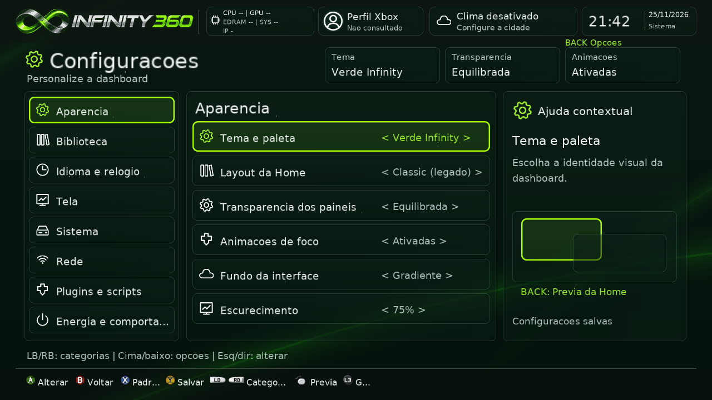

# INFINITY 360

**Dashboard open-source para Xbox 360 · V0.3.41 Alpha (código-fonte)**

**Controle:** L3 abre o Guide; BACK abre as opções da tela (A seleciona, B fecha); R3 sozinho não executa ações. L3+R3 captura tela no presenter XSDK. Durante IPTV XSDK, START fixa o HUD e L3 abre o Guide de consulta; outras funções exigem sair da reprodução.

Interface nativa em 720p inspirada no Xbox Series, com navegação por controle, biblioteca, IPTV, gerenciamento de conteúdo e personalização. Anteriormente AuroraX; Cloud360 IPTV mantém sua identidade.

[Releases](https://github.com/MichaelPriest/Infinity360/releases) · [Changelog](CHANGELOG.md) · [Roadmap](Platform/Xbox360/docs/ROADMAP-PRIORITIES.md)

**Prioridade atual: Cloud360 IPTV e FFmpeg.** [Ordem de desenvolvimento](Platform/Xbox360/docs/ROADMAP-PRIORITIES.md).

## Interface nativa

| Home | Guide |
| --- | --- |
|  |  |
| **Biblioteca** | **Detalhes do jogo** |
|  |  |
| **INFINITY Store** | **Cloud360 IPTV** |
|  |  |
| **Configurações** | **Sistema** |
|  |  |

**[Galeria de capturas nativas](docs/screenshots/README.md)** · [Commit das imagens](docs/screenshots/source.txt)

Capturas do renderizador C++ com dados de teste, não fotografias do console. A galeria pode estar em revisão anterior ao código.

## Funcionalidades

| Módulo | Estado no código |
| --- | --- |
| Home e Guide | Menu horizontal, cards translúcidos e foco animado; L3 abre/fecha o Guide em todas as telas do menu, com retorno à tela anterior; atalhos agrupados, perfil, relógio e clima |
| Biblioteca | XEX/GOD/XBLA, recentes, favoritos, capas frente/verso e multidisco. Filtros, ordenação e legendas em [Lua](Platform/Xbox360/docs/LUA-API.md) |
| Perfil Xbox | Seleção, Gamerpic, retrato e imagem estática de corpo inteiro do avatar (atualização opcional), diagnóstico de componentes e memória de assets, Gamerscore e conquistas por título via XAM experimental |
| Social | Cartão próprio/de amigos, lista de amigos/presença e amigos por título, jogadores recentes, edição de perfil, composição oficial de mensagens, central de comunicação/Party, consulta de permissões, chat e editor de avatar via XAM experimental; painel de avatar e leitor de geometria oficial e rasterização diagnóstica CPU e adaptador XAvatar/D3D9 e pass para textura opcionais (não integrados ao presenter XSDK), preferência visual Avatar/Gamerpic/Oculto |
| Conteúdo | TU, DLC, saves, backups; Homes modernas detectam DVD legível, executa XEX e abre instalação HDD/USB (GOD ou extração) |
| Store e downloads | Catálogo homebrew, fila persistente, fontes configuráveis e importação local de metadados Andromeda |
| Cloud360 IPTV | FFmpeg integrado ao pacote principal (MP4/TS/HLS e fMP4 restrito; H.264/MPEG-2, AAC/MP2/MP3/AC-3/E-AC-3); recuperação limitada de live HLS e redução adaptativa de bitrate com reinicialização do decoder, preservando volume e mudo; pré-leitura cooperativa limitada; entrada experimental até 1080p reduzida a 720p, seleção HLS Full HD opt-in; homologação física pendente |
| Sistema | Hub com cinco categorias, arquivos e notificações com painéis de detalhe, telemetria ampliada, FTP, rede, SMB experimental, armazenamento e sensores |
| Personalização | Configurações em oito categorias, valores diretos, ajuda contextual e prévia em sete paletas, navegação LB/RB, prévia e edição com salvar/cancelar; sete temas, três idiomas, quatro níveis de vidro (leve, equilibrado, denso e opaco), transparência real sobre o fundo, grupos com vidro leve sem acumular opacidade, barras integradas ao tema e animações temporizadas opcionais |

Implementação no código não equivale a homologação física.

## Instalação e desenvolvimento

O ZIP `Infinity360-<versão>-Xbox360.zip` é o pacote de instalação unificado com FFmpeg. O ZIP complementar `candidate` contém fontes LGPL, objetos para relink e diagnósticos; não é necessário copiá-lo ao console.

- **Xbox 360:** [instalação e requisitos](Platform/Xbox360/README.md), [guia Alpha XSDK](IPTV/Cloud360/native/AURORAX-ALPHA-XSDK.md) e [Releases](https://github.com/MichaelPriest/Infinity360/releases). Não substitua a dashboard instalada por revisão não homologada.
- **PC:** `cmake -S . -B build`, `cmake --build build` e `./build/aurorax`.
- **Prévia web:** `python -m http.server 8080` e abra `http://localhost:8080/Web/`. Usa dados de teste.

## Documentação

[Arquitetura modular e estrutura de instalação](Platform/Xbox360/docs/ARCHITECTURE.md) · [Importação Nexus](Platform/Xbox360/docs/NEXUS-IMPORT.md)

| Recurso | Link |
| --- | --- |
| Histórico de versões | [CHANGELOG](CHANGELOG.md) |
| Roadmap e prioridades | [ROADMAP](Platform/Xbox360/docs/ROADMAP-PRIORITIES.md) |
| Perfil e serviços sociais | [SOCIAL-PROFILE](Platform/Xbox360/docs/SOCIAL-PROFILE.md) |
| Design e interface | [MODERN-UI](Platform/Xbox360/docs/MODERN-UI.md) |
| Histórico técnico e instruções anteriores | [DEVELOPMENT-NOTES](DEVELOPMENT-NOTES.md) |
| Capturas e testes | [GitHub Actions](https://github.com/MichaelPriest/Infinity360/actions) |

O projeto não distribui jogos comerciais, ROMs, chaves, firmware proprietário ou conteúdo protegido. Builds XEX e releases são solicitadas separadamente. A validação no Xbox 360 permanece pendente.
