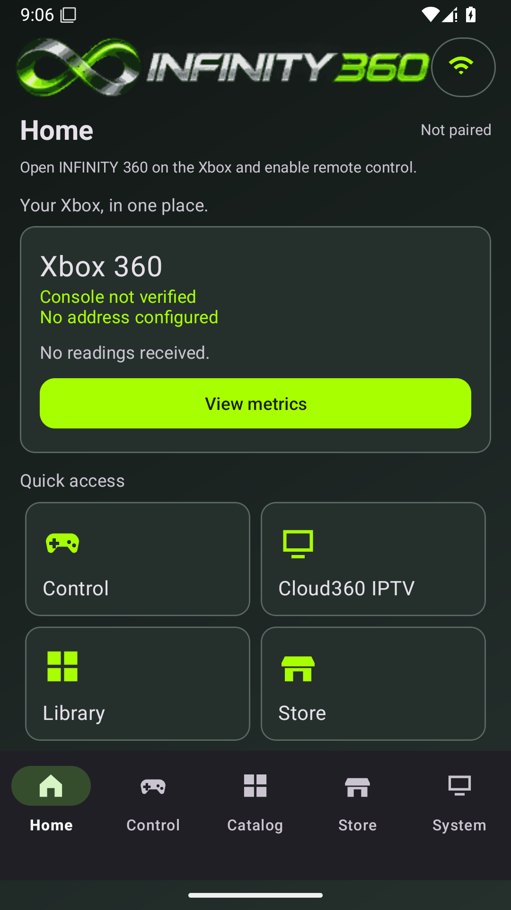
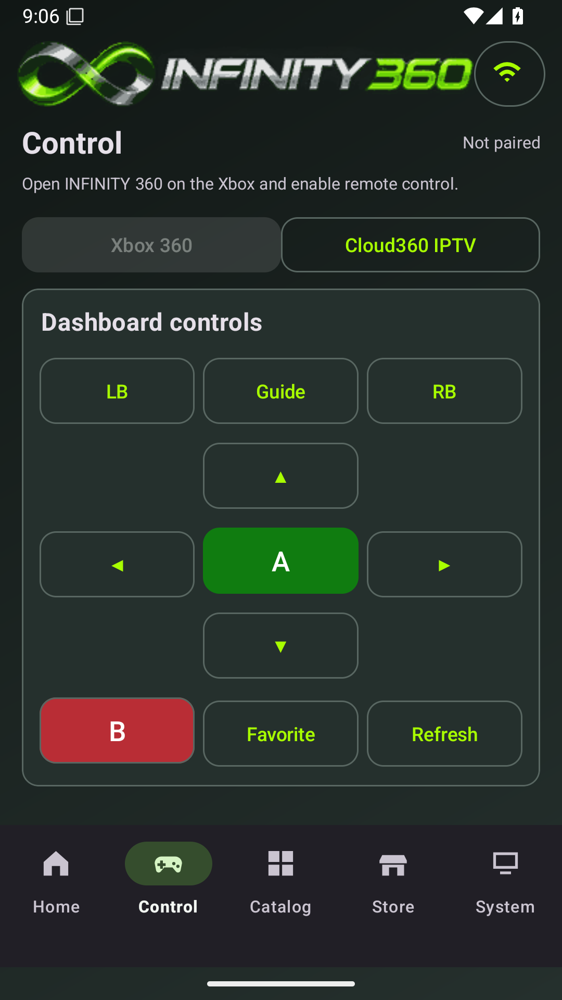
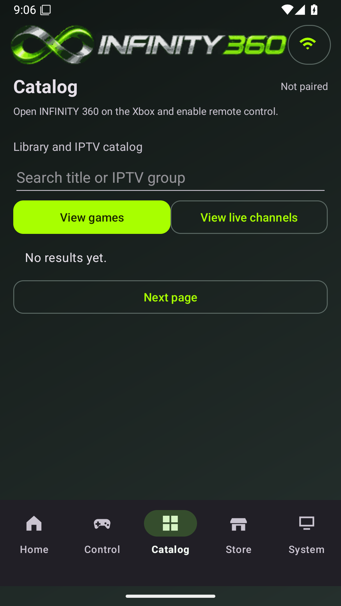
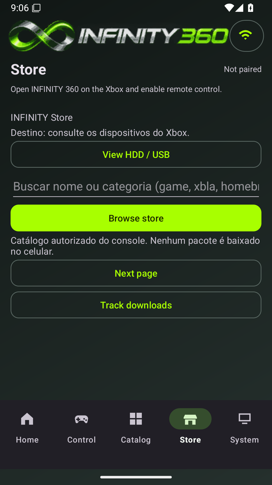
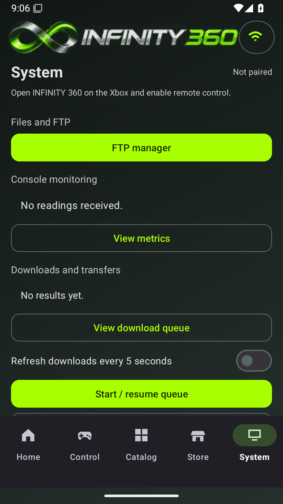
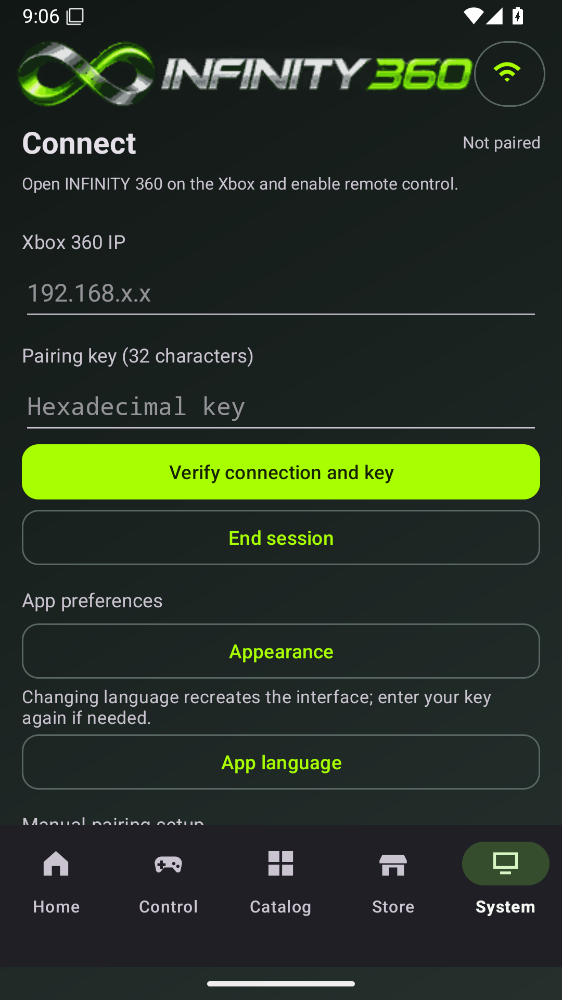
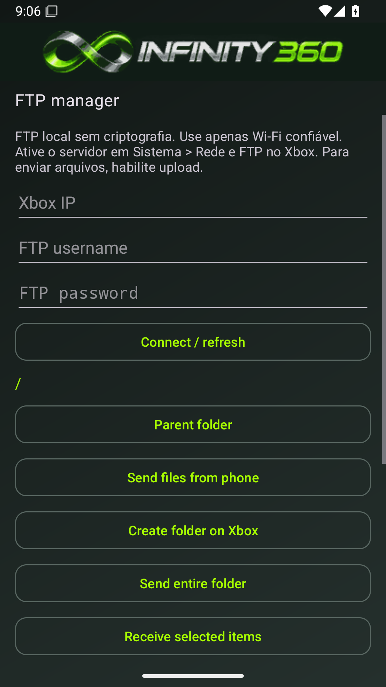

# INFINITY 360 Remote — capturas do APK

Esta galeria contém somente imagens obtidas do APK em execução no emulador Android. Não são mockups; o console permanece desconectado durante a captura.

<!-- ANDROID-GALLERY-BEGIN -->

**Capturas reais do APK no emulador Android** — [commit f138ba305399](https://github.com/MichaelPriest/Infinity360/commit/f138ba3053994203a1bfee35c09a63483c35df37).
Console desconectado; sem dados ou credenciais reais. Não representa homologação física.

| Tela | Tela |
| --- | --- |
| **Início** | **Controle** |
|  |  |
| **Catálogo** | **Loja** |
|  |  |
| **Sistema e downloads** | **Conexão** |
|  |  |
| **Gerenciador FTP** |  |
|  |  |

<!-- ANDROID-GALLERY-END -->

Para gerar localmente, compile `:app:assembleDebug :app:assembleDebugAndroidTest` e execute `bash Android/tools/capture_instrumented.sh docs/android-screenshots` a partir da raiz, com um emulador descartável. O script limpa os dados e usa instrumentação para verificar as seções visíveis antes de fotografar a tela. As capturas não comprovam conexão, download, FTP ou reprodução de IPTV no Xbox.
