# Galeria de capturas nativas — INFINITY 360

[Voltar ao README](../../README.md) · [Origem das capturas](source.txt)

<!-- NATIVE-GALLERY-BEGIN -->

**72 capturas nativas** — commit [60d31fcba62e](https://github.com/MichaelPriest/Infinity360/commit/60d31fcba62e7ff87e774f68d2c88fbf04d175a0).

As legendas descrevem o conteúdo exibido e o modo de acesso. As capturas usam dados de teste; diagnósticos, perfis e integrações indisponíveis não demonstram funcionamento físico.

### Tela inicial e Guide

| Tela | Tela |
| --- | --- |
|  | 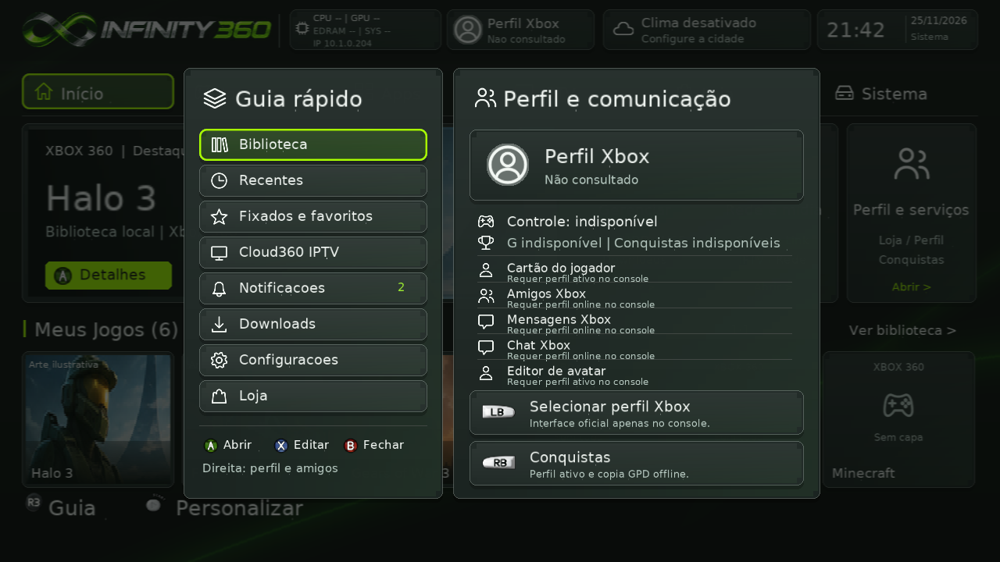 |
| **Tela inicial — Series Infinity (layout padrão)** | **Guia rápido — atalhos e painel de perfil** |
|  |  |
| **Guia rápido — personalização dos atalhos** | **Tela inicial — perfil local de teste** |
|  |  |
| **Guia rápido — perfil de teste, mensagens, chat e editor de avatar (indisponíveis no host)** | **Home — grupo Sistema, com funções secundárias** |

### Biblioteca e conteúdo de jogos

| Tela | Tela |
| --- | --- |
|  |  |
| **Biblioteca — visualização em lista** | **Biblioteca — visualização em grade** |
|  |  |
| **Biblioteca — foco nos filtros de categorias** | **Detalhes do jogo — acesso pela biblioteca em lista** |
| 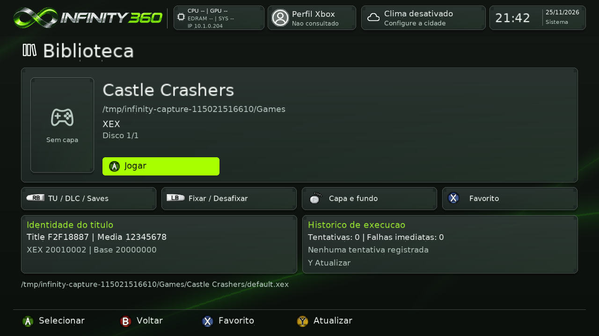 |  |
| **Detalhes do jogo — acesso pela biblioteca em grade** | **Conteúdo instalado — Title Updates (TU)** |
|  | 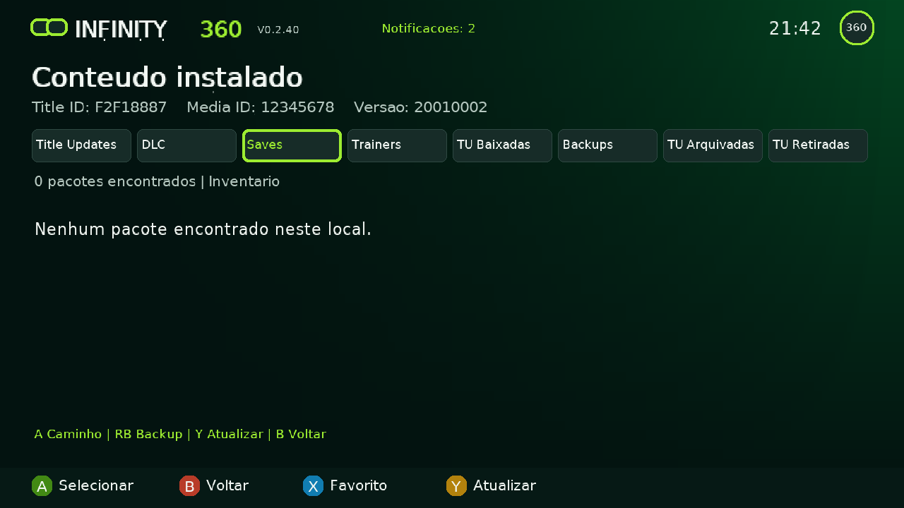 |
| **Conteúdo instalado — DLC** | **Conteúdo instalado — Saves** |
| 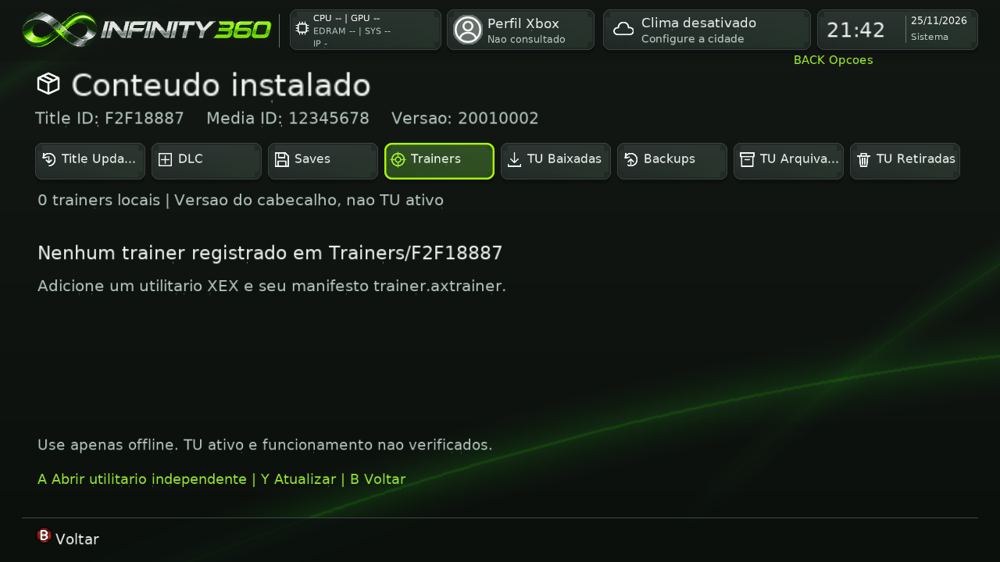 |  |
| **Conteúdo instalado — Trainers locais** | **Conteúdo instalado — TU baixadas** |
|  | 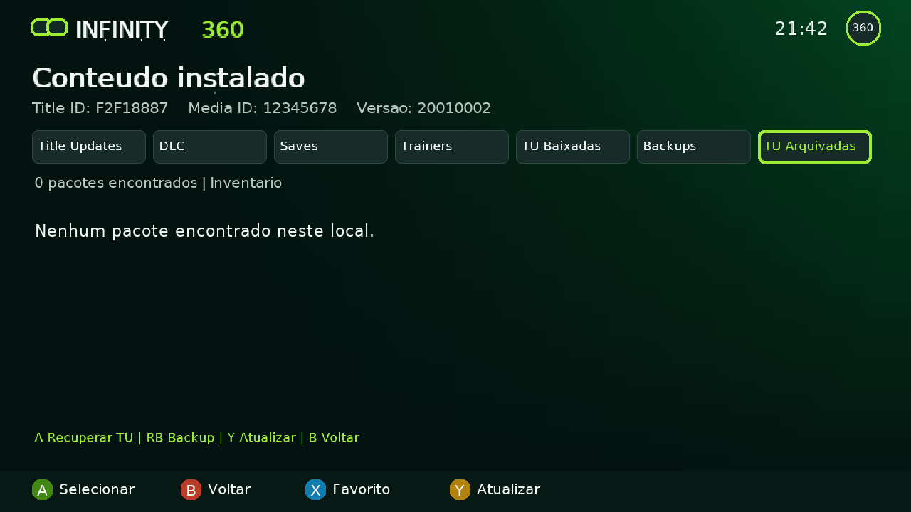 |
| **Conteúdo instalado — backups** | **Conteúdo instalado — TU arquivadas** |
|  |  |
| **Conteúdo instalado — TU retiradas** |  |

### Aplicativos, loja e mídia

| Tela | Tela |
| --- | --- |
| 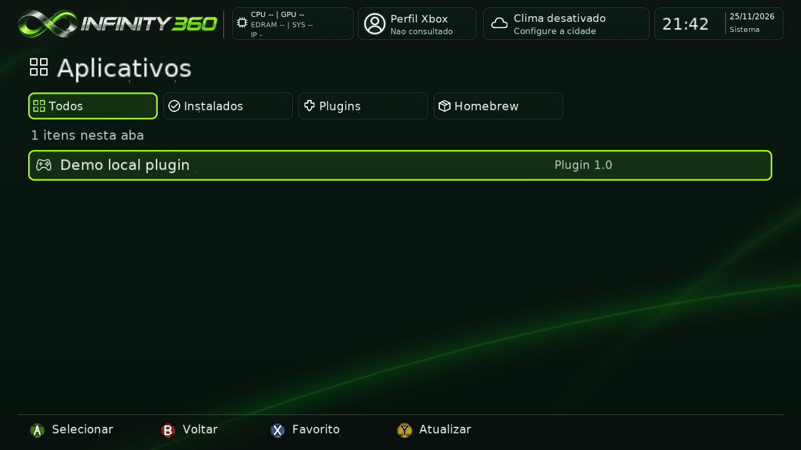 |  |
| **Aplicativos — catálogo local e plugins** | **Emuladores — catálogo sem itens de teste** |
|  |  |
| **INFINITY Store — catálogo e resumo do item** | **INFINITY Store — detalhes e ações do produto** |
|  |  |
| **INFINITY Store — catálogo acessado pelo Series Infinity** | **INFINITY Store — produto acessado pelo Series Infinity** |
|  |  |
| **INFINITY Store — central de fontes e provedores** | **Cloud360 IPTV — categoria TV ao vivo** |
|  |  |
| **Cloud360 IPTV — categoria Todos** |  |

### Sistema, arquivos e downloads

| Tela | Tela |
| --- | --- |
|  |  |
| **Sistema — menu de seções e resumo local** | **Gerenciador de arquivos — navegação local** |
|  |  |
| **Armazenamento — dispositivos e espaço disponível** | **Downloads — transferências locais** |
|  |  |
| **Downloads — fila de itens da INFINITY Store** | **Instalador de DVD — extração XEX e opções GOD/XBLA** |
|  |  |
| **Plugins residentes — leitura do launch.ini (DashLaunch)** | **Plugins locais — gerenciamento dos atalhos** |
| 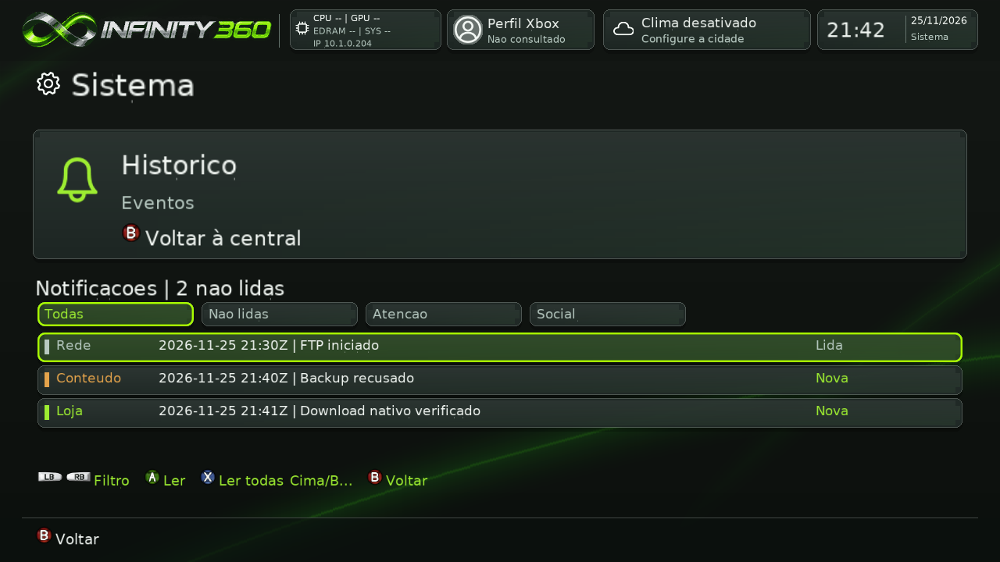 |  |
| **Notificações — histórico completo de eventos** | **Notificações — filtro Não lidas** |
| 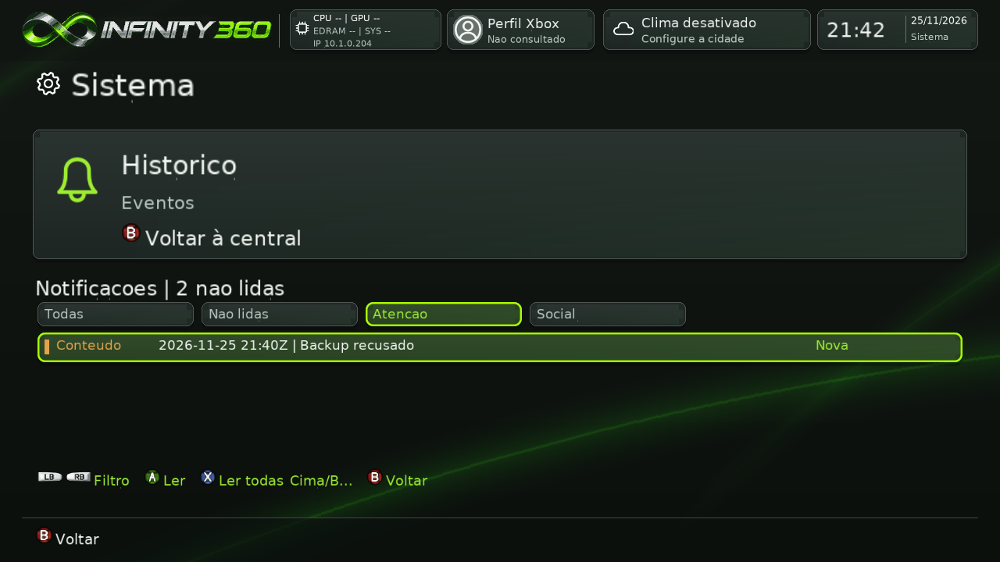 |  |
| **Notificações — filtro Atenção** |  |

### Rede e diagnóstico

| Tela | Tela |
| --- | --- |
|  | 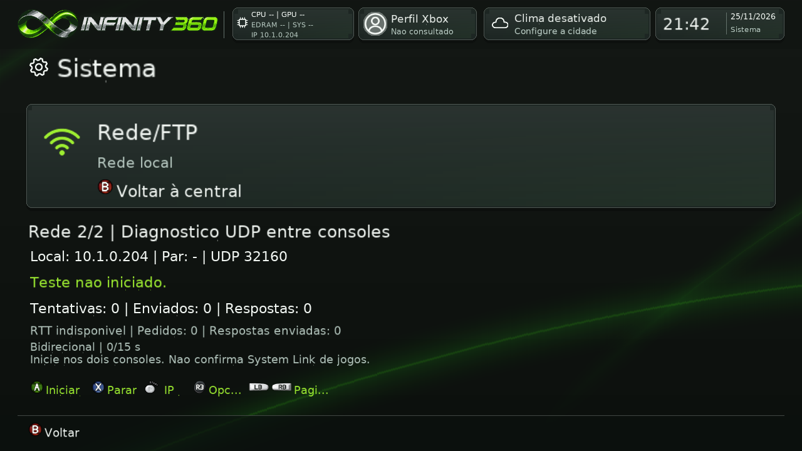 |
| **Rede — diagnóstico IPv4 e serviços FTP** | **Rede — diagnóstico UDP entre consoles** |
| 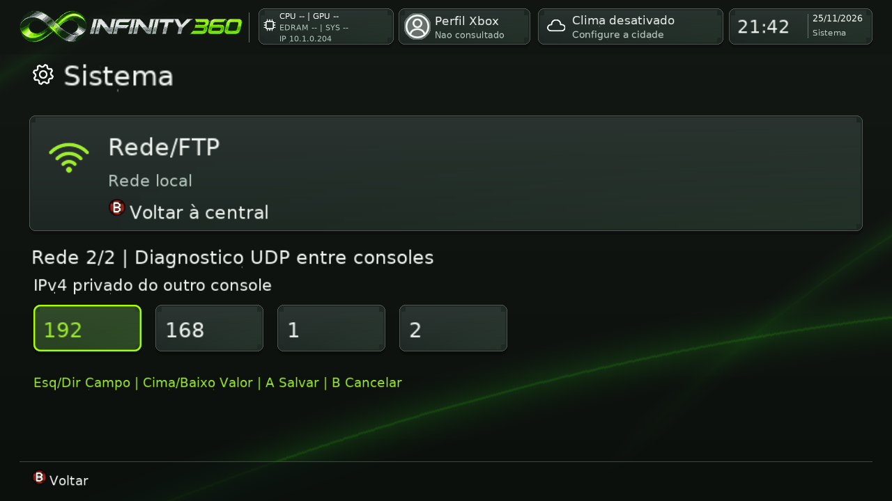 | 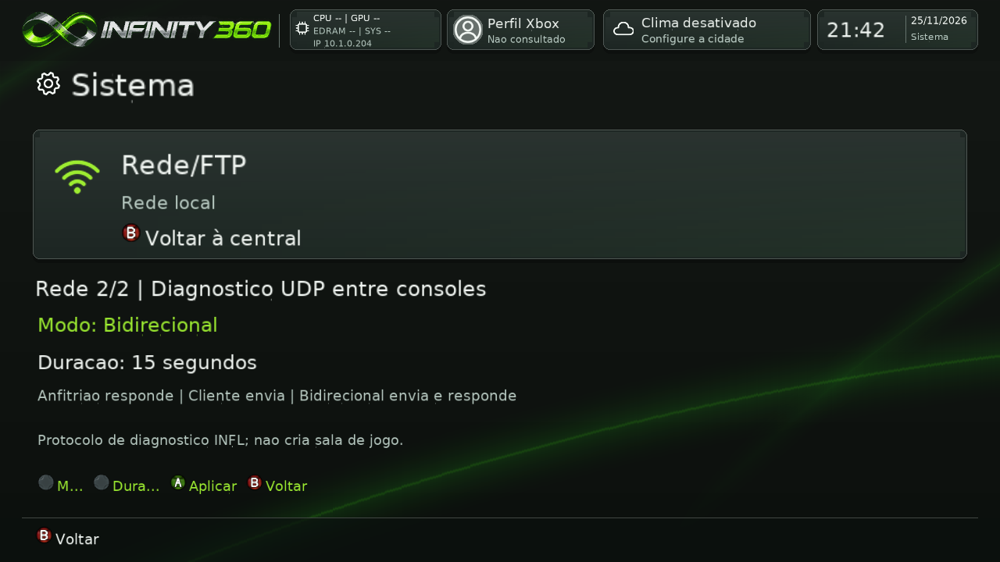 |
| **Rede — configuração do IPv4 do outro console** | **Rede — modo e duração do diagnóstico UDP** |
|  |  |
| **Rede — diagnóstico SMB2/3 (experimental)** | **Rede — configuração do IPv4 do servidor SMB** |

### Console, perfis e telemetria

| Tela | Tela |
| --- | --- |
| 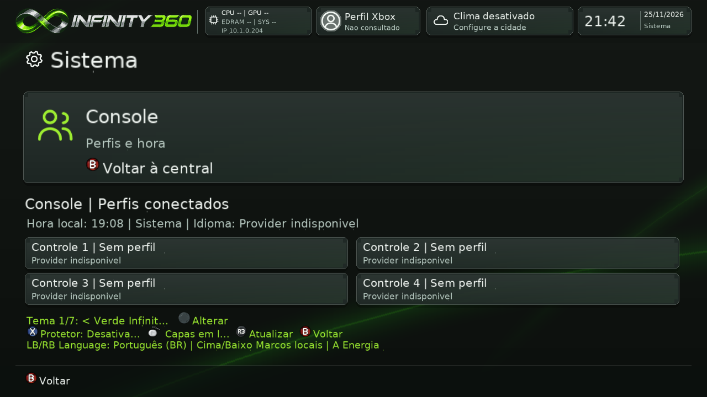 |  |
| **Console — perfis conectados e preferências** | **Telemetria — memória e sensores (página 1/2)** |
|  |  |
| **Telemetria — vídeo, kernel e margem segura (página 2/2)** | **Temperaturas SMC — CPU, GPU, EDRAM e chassi (experimental)** |
|  |  |
| **Refrigeração — diagnóstico SMC e limite de aviso** | **Energia — desligar ou reiniciar (experimental)** |
| 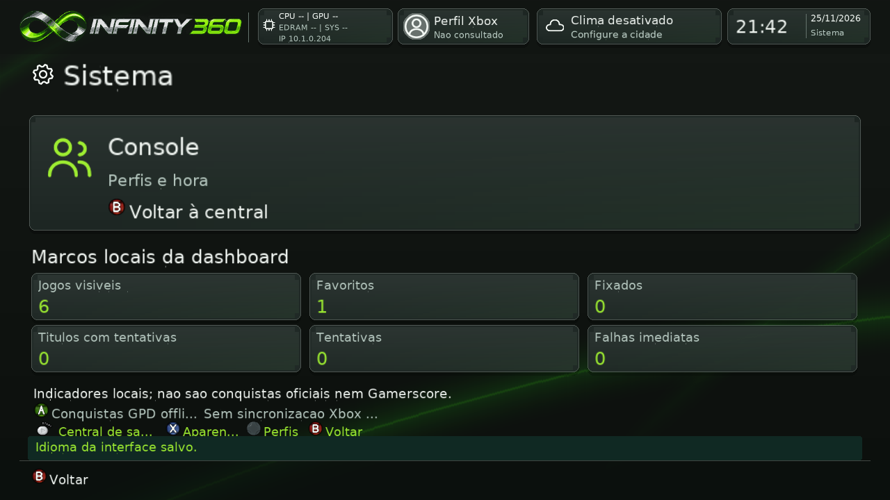 | 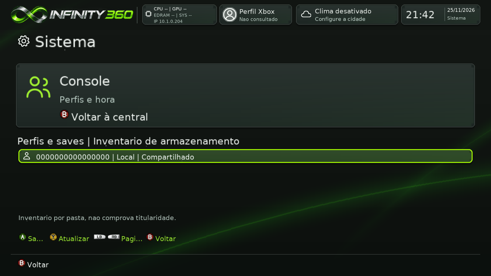 |
| **Marcos locais — indicadores da dashboard (não são Gamerscore)** | **Perfis e saves — inventário de armazenamento** |
|  |  |
| **Conquistas Xbox — importação de GPD offline** | **Aparência — paleta, fundo, layout, biblioteca, UTC e clima** |

### Temas e idiomas

| Tela | Tela |
| --- | --- |
|  | 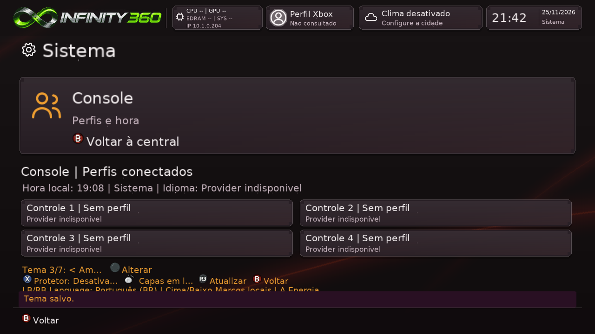 |
| **Configurações do console — tema Azul** | **Configurações do console — tema Âmbar** |
|  |  |
| **Configurações do console — tema Violeta** | **Configurações do console — tema Vermelho** |
|  |  |
| **Configurações do console — tema Ciano** | **Configurações do console — tema Grafite** |
| 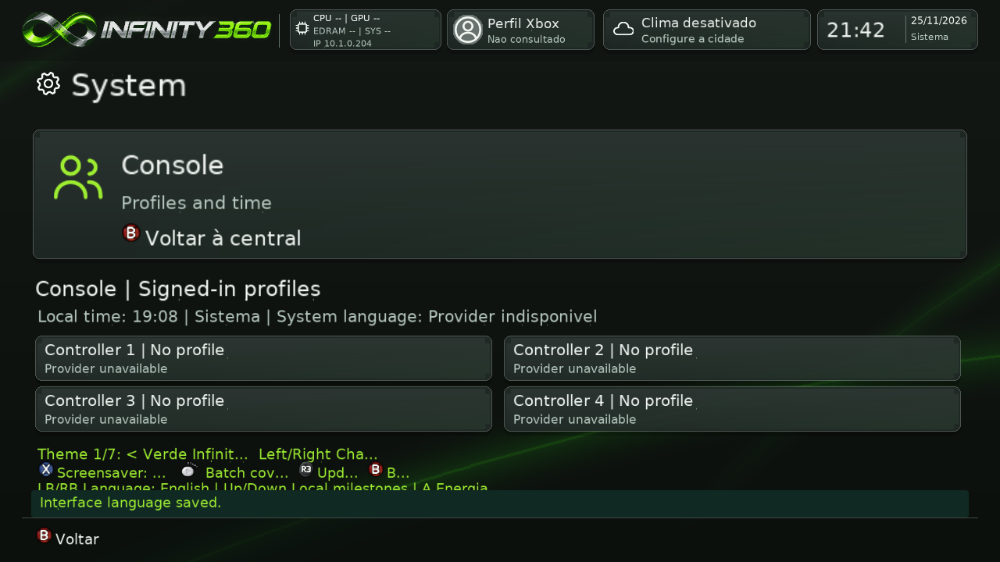 |  |
| **Configurações do console — idioma inglês** | **Configurações do console — idioma espanhol** |

### Layouts da Home

| Tela | Tela |
| --- | --- |
|  |  |
| **Series Infinity — menu horizontal (padrão)** | **Lateral Pro — menu vertical** |
|  | 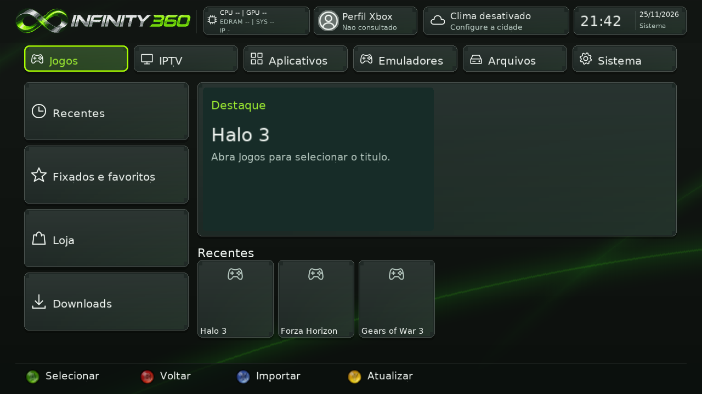 |
| **Hybrid — menu superior e lateral** | **Blade Neo — navegação em painéis** |
|  |  |
| **Immersive — destaque amplo e menu inferior** | **Minimal — navegação em grade** |
|  | 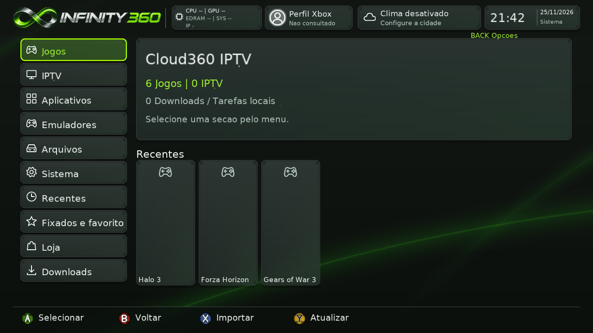 |
| **Arcade — biblioteca e menu inferior** | **Media Hub — destaque de mídia e menu lateral** |
|  |  |
| **Performance — indicadores locais e menu em duas colunas** |  |

<!-- NATIVE-GALLERY-END -->
